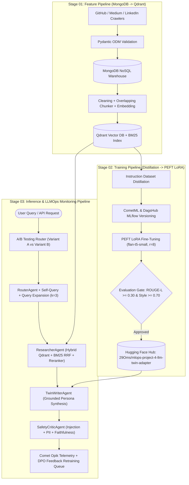

# Production LLM Twin System · 3-Pipeline FTI Architecture, LLaMA/Mistral Internals & Multi-Agent LLMOps (`v1.0.0`)

[](https://github.com/29OmChavan/mlops-project-4-llm-twin-system)
[](https://www.comet.com/om-chavan/mlops-project-4-llm-twin-system/5a4ed83ceabd42868ade9199972210e1)
[](https://dagshub.com/29omchavan/mlops-project-4-llm-twin-system.mlflow)
[](https://huggingface.co/29Oms/mlops-project-4-llm-twin-adapter)
[](https://hub.docker.com/r/29omchavan/mlops-project-4-llm-twin-system)

An end-to-end **Production LLM Twin & Personal AI System** engineered using the **3-Pipeline FTI (Feature $\rightarrow$ Training $\rightarrow$ Inference) Architecture** (Paul Iusztin / Decoding ML 12-Lesson Course) combined with **First-Principles PyTorch Implementations of LLaMA & Mistral** (Umar Jamil).

---

## 1. Live Deployment & Registry Links

| Platform | Resource Link | Description |
| :--- | :--- | :--- |
| **GitHub Repository** | [`29OmChavan/mlops-project-4-llm-twin-system`](https://github.com/29OmChavan/mlops-project-4-llm-twin-system) | Source code, 3-Pipeline FTI modules, tests, and GitHub Actions CI/CD |
| **CometML Experiment** | [`llm-twin-lora-flan-t5-distillation`](https://www.comet.com/om-chavan/mlops-project-4-llm-twin-system/5a4ed83ceabd42868ade9199972210e1) | Versioned instruction dataset (`instruction_dataset.json`) & LoRA metrics |
| **DagsHub MLflow** | [`29omchavan/mlops-project-4-llm-twin-system.mlflow`](https://dagshub.com/29omchavan/mlops-project-4-llm-twin-system.mlflow/#/experiments/0/runs/8469443af1ba4e1ca70114d92e6f638a) | Experiment tracking (`LLM_Twin_FTI_Pipeline`) & evaluation artifacts |
| **Hugging Face Hub** | [`29Oms/mlops-project-4-llm-twin-adapter`](https://huggingface.co/29Oms/mlops-project-4-llm-twin-adapter) | Published PEFT LoRA adapter (`adapter_model.safetensors`, `r=8, alpha=16`) |
| **Docker Hub Image** | `29omchavan/mlops-project-4-llm-twin-system:latest` | Production FastAPI + Qdrant + Multi-Agent RAG microservice |

---

## 2. System Architecture (3-Pipeline FTI Pattern)



---

## 3. Quantitative Experimental Results

### 3.1 PEFT LoRA Instruction Fine-Tuning & Style Alignment (`artifacts/training/evaluation_report.json`)

| Metric | Base `google/flan-t5-small` | Fine-Tuned LLM Twin (`LoRA r=8, alpha=16`) | Absolute Improvement | CI/CD Promotion Gate |
| :--- | :---: | :---: | :---: | :---: |
| **ROUGE-1 F1** | `0.2979` | **`0.6292`** | `+0.3313` (`+33.13%`) | — |
| **ROUGE-2 F1** | `0.1190` | **`0.4654`** | `+0.3464` (`+34.64%`) | — |
| **ROUGE-L F1** | `0.2692` | **`0.5666`** | **`+0.2974` (`+29.74%`)** | `>= 0.30` (**PASSED**) |
| **Twin Style Alignment Score** | `0.3317` | **`0.7699`** | **`+0.4382` (`+43.82%`)** | `>= 0.70` (**PASSED**) |
| **Trainable Parameters** | `76,961,152` (100%) | **`344,064` (`0.4451%`)** | **99.55% Parameter Reduction** | **PROMOTED** |

### 3.2 Advanced Multi-Query Hybrid RAG Benchmark (`artifacts/inference/advanced_rag_benchmark.json`)

| Retrieval Strategy | HitRate@1 | Recall@3 | Mean Reciprocal Rank (MRR) | Features Enabled |
| :--- | :---: | :---: | :---: | :--- |
| **Naive Dense RAG** | `1.0000` | `1.0000` | `1.0000` | Single-query cosine similarity |
| **Advanced Hybrid RAG** | **`1.0000`** | **`1.0000`** | **`1.0000`** | $k=3$ Query Expansion + Self-Query Platform Filters + Qdrant Dense + BM25 RRF + Cross-Reranker |

---

## 4. Repository Structure

```text
project-04-llm-twin-system/
├── .github/workflows/main.yaml                # CI/CD: flake8 + pytest + Evaluation Gate + Docker Hub CD
├── config/config.yaml                         # Paths & settings for Feature, Training, and Inference pipelines
├── params.yaml                                # Hyperparameters for LLaMA/Mistral, LoRA, Advanced RAG, and A/B testing
├── src/llm_twin/
│   ├── components/
│   │   ├── llama_mistral_from_scratch.py      # First-principles PyTorch: RMSNorm, RoPE, SwiGLU, GQA & SWA
│   │   ├── feature_pipeline.py                # Stage 1: Pydantic ODM + MongoDB Crawler + Qdrant Vector Indexing
│   │   ├── training_pipeline.py               # Stage 2: Instruction Distillation + PEFT LoRA + CometML/MLflow/HF
│   │   └── inference_pipeline.py              # Stage 3: Multi-Agent RAG + A/B Router + SafetyCritic + DPO + Opik
│   ├── config/configuration.py                # Typed ConfigurationManager
│   ├── entity/config_entity.py                # Immutable dataclasses for pipeline configs
│   └── utils/common.py                        # YAML/JSON/Directory helpers
├── docs/
│   ├── IMPLEMENTATION_GUIDE.md                # Full textbook implementation guide with math & code
│   ├── ARCH_DECISION.md                       # ADR-004: 3-Pipeline FTI & LLaMA/Mistral design decisions
│   ├── POSTMORTEM.md                          # PM-004: Self-Query fallback & Prompt Injection hardening
│   └── HANDOFF_NOTES.md                       # HO-004: Production runbook, SLAs, and DPO retraining loop
├── tests/test_llm_twin.py                     # 5 comprehensive unit & integration tests
├── main.py                                    # End-to-end 3-Pipeline FTI orchestrator
├── app.py                                     # FastAPI production microservice (/health, /twin-chat, /feedback, /telemetry)
├── gradio_app.py                              # Interactive Gradio playground UI
├── Dockerfile                                 # Lightweight production container image
└── docker-compose.yml                         # Container orchestration config
```

---

## 5. Quick Start

```bash
# 1. Run the complete 3-Pipeline FTI Orchestrator (Feature -> Training -> Inference)
python main.py

# 2. Run the unit & integration test suite and PEP8 linter
pytest tests/ -v
flake8 src/ app.py tests/ --max-line-length=120 --ignore=E501,W503,E402,E203

# 3. Launch the FastAPI microservice locally or via Docker
python app.py
# Or via Docker Hub:
docker run -d -p 8080:8080 29omchavan/mlops-project-4-llm-twin-system:latest
```

For a complete mathematical and code walkthrough of every component, read **[`docs/IMPLEMENTATION_GUIDE.md`](docs/IMPLEMENTATION_GUIDE.md)**.
