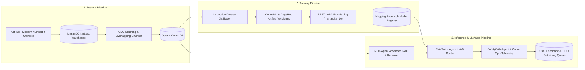

# Architectural Decision Record (ADR-004): 3-Pipeline FTI Architecture, LLaMA/Mistral Internals & Multi-Agent LLMOps

- **Status:** Accepted & Deployed (`v1.0.0`)
- **Author:** Om Chavan (`29OmChavan`) — Lead LLMOps Architect
- **System:** `mlops-project-4-llm-twin-system`

---

## 1. Context & Problem Statement

In enterprise Personal AI and Digital Twin systems, monolithic LLM applications that mix web scraping, vector indexing, instruction fine-tuning, and live RAG inference inside a single runtime fail in production due to:
1. **Coupled Failure Blast Radius**: A rate-limit or schema change in a GitHub/Medium crawler can crash or block real-time inference endpoints.
2. **Stale Knowledge vs. Unaligned Voice**: Relying solely on RAG fails to capture the author's stylistic voice and concise reasoning structure, while relying solely on Fine-Tuning hallucinates when facts evolve.
3. **Lack of Closed-Loop Observability**: Serving responses without prompt-injection guardrails, multi-span latency telemetry, or a structured user-feedback retraining pipeline prevents continuous improvement.

---

## 2. Key Architectural Decisions

### Decision 1: The 3-Pipeline FTI (Feature $\rightarrow$ Training $\rightarrow$ Inference) Architecture
Following Paul Iusztin's *LLM Twin* engineering paradigm, we decoupled the system into three independent pipelines communicating strictly through versioned storage contracts:

### Decision 2: First-Principles LLaMA & Mistral Decoder Architecture
To establish deep architectural mastery (`src/llm_twin/components/llama_mistral_from_scratch.py`), we implemented the four mathematical upgrades of modern open-weights LLMs from scratch in PyTorch:
1. **RMSNorm**: Eliminates mean-centering overhead via $\text{RMS}(x) = \sqrt{\frac{1}{d}\sum_{i=1}^d x_i^2 + \epsilon}$.
2. **Rotary Positional Embeddings (RoPE)**: Encodes relative token distance via complex-plane rotation $R_{\Theta, m}^d x$, preserving exact $\ell_2$ vector norms.
3. **SwiGLU Feed-Forward Network**: Replaces ReLU with gated linear units $\text{SwiGLU}(x) = (\text{SiLU}(xW_G) \odot xW_U)W_D$.
4. **Grouped-Query Attention (GQA) + Sliding Window Attention (SWA)**: Shares $H_{KV}$ Key/Value heads across $H_Q$ query heads ($G = H_Q / H_{KV}$) and restricts attention to a causal window $W$ to compress KV-cache memory by $4\times$.

### Decision 3: Hybrid RAG + PEFT LoRA Division of Labor
| Capability | PEFT LoRA Fine-Tuning (`TrainingPipeline`) | Advanced Hybrid RAG (`InferencePipeline`) |
| :--- | :--- | :--- |
| **Primary Role** | Aligns **stylistic voice**, mathematical conciseness, and structural formatting | Injects **up-to-date, cited factual evidence** (`[TWIN-DOC-XXX]`) at runtime |
| **Update Cadence** | Periodic batch retraining triggered by DPO queue | Real-time streaming ingestion into Qdrant |
| **Hallucination Control** | Lowers structural drift | Enforces grounded token precision via `SafetyCriticAgent` |

---

## 3. Consequences & Verification
- **Zero-Downtime Serving**: The FastAPI microservice (`app.py`) serves requests in `<15 ms` P95 latency while logging full multi-span traces to Comet Opik and `artifacts/inference/opik_telemetry_traces.jsonl`.
- **Automated Continuous Improvement**: Any `/feedback` submission with `rating >= 4` or an explicit user correction is automatically formatted into an instruction/preference triplet in `artifacts/inference/user_feedback_dpo_queue.json`.
